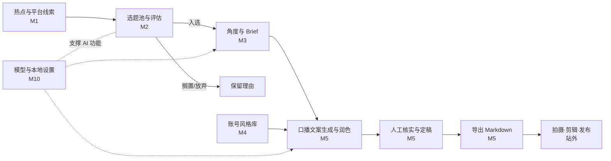

# OneStudio 需求文档（v0.1 精简版）

> 短视频博主自媒体创作工作台 · 账号定位：AI 知识科普（面向 AI 小白）
> 主要发布平台：抖音、小红书 ｜ 文档更新：2026-10-22 ｜ 状态：待评审

---

## 1. 项目概述

### 1.1 背景与问题

账号做的是「AI 工具使用技巧」类科普，包括 WorkBuddy 小技巧、Codex 使用小技巧、用 WorkBuddy 制作爆火视频的「知识大赏」等，形式为**真人出镜口播 + 屏幕演示**，主要发布在**抖音和小红书**。

当前优先解决三个问题：

1. **找选题耗时**：AI 工具更新快，需要同时关注行业热点和抖音、小红书观众感兴趣的内容。
2. **选题到写稿流程分散**：判断值不值得做、确定切入角度、按账号风格写稿缺少统一工作区。
3. **文案质量不稳定**：AI 初稿容易模板化，功能、版本、价格和操作步骤需要人工核实，改稿需要保留历史。

### 1.2 产品定位

OneStudio 是一个**本地优先、面向个人的选题与文案创作工作台**。首版跑通以下主线：

```
发现热点/录入平台线索 → 评估选题 → 确定角度 → 按账号风格写稿 → 润色与核实 → 导出口播文案
```

拍摄、剪辑和发布在站外完成。先验证这条主线能否减少找选题和改稿的时间，再决定是否扩展下游功能。

### 1.3 目标

| 编号 | 目标 | 衡量方式（初版建议） |
|---|---|---|
| G1 | 减少每天找选题的时间 | 每日打开热点雷达后 ≤10 分钟完成筛选 |
| G2 | 选题决策有依据 | 入选、搁置、放弃均记录理由；入选选题有评分 |
| G3 | 文案贴合账号风格 | 初稿“风格一致性”人工评分 ≥4/5 |
| G4 | 产出可用于口播准备的文案 | 包含完整正文、目标平台、时长估算与待核实项，可导出 Markdown |
| G5 | 改稿不丢失历史 | 可查看、对比、恢复历史稿件，并查看对应来源与风格版本 |

---

## 2. 用户与账号画像

| 项 | 内容 |
|---|---|
| 用户 | 博主本人，独立完成策划、出镜、写稿和剪辑 |
| 技术背景 | 能本地部署与配置 API Key，希望工具易用、可调整 |
| 主要发布平台 | 抖音、小红书 |
| 领域与受众 | AI 知识科普，面向希望“看完就能用”的 AI 小白 |
| 内容支柱 | WorkBuddy 小技巧、Codex 使用小技巧、AI 热点解读 |
| 内容形式 | 真人出镜口播 + 屏幕演示，首版围绕短视频口播稿设计 |
| 风格输入 | 历史代表作文案 + 用户手动补充的语气、结构与禁用词 |

---

## 3. 核心业务流程



**选题状态**：`待评估 → 已入选 → 写作中 → 已定稿`；分支状态为 `搁置`、`放弃`。入选、搁置、放弃需记录一句话理由；已定稿内容继续修改时回到写作中。首版不跟踪拍摄、发布和复盘状态。

---

## 4. 功能需求

优先级：**P0** = 首版必须；**P1** = 核心流程验证后的可选增强，不作为首版交付条件。沿用原有模块和功能编号，删减项不重新编号。

### M1 热点采集与发现

| ID | 需求 | 优先级 | 验收要点 |
|---|---|---|---|
| F-101 | 信源管理：首版支持 RSS 与手动录入链接、标题、摘要、参考文本；标记来源为抖音、小红书或其他公开信源。官方更新优先通过 RSS 或手动录入接入 | P0 | 可增删改信源；平台链接无法自动读取时仍可补充文本并保存，不要求首版解析任意网页 |
| F-102 | RSS 定时采集，默认每日运行，支持手动刷新、有限重试与简要运行日志 | P0 | 单信源失败不影响其他信源；可查看最近成功时间与失败原因 |
| F-103 | 基础去重与事件归并：相同链接自动去重，疑似同事件提示人工合并，保留原始来源 | P0 | 重复链接不新增卡片；合并后仍可查看所有来源 |
| F-104 | 领域过滤：关键词 + 账号兴趣描述，AI 给出相关度与理由；模型失败时回退关键词匹配 | P0 | 可查看过滤依据，失败时仍能浏览和筛选线索 |
| F-106 | 抖音、小红书热点及对标作品导入：后续接入 TrendRadar 可用输出或 MediaCrawler 导出数据，统一映射标题、链接、平台、时间和摘要等字段 | P1 | 接入前确认格式与使用条件；导入有去重和错误提示，不以自动抓取成功作为首版条件 |

首版先用少量稳定信源和手动录入跑通流程；不做全网采集、独立热榜爬虫、评论采集、日报推送或对标账号持续监控。

### M2 选题池与“值不值得做”评估

| ID | 需求 | 优先级 | 验收要点 |
|---|---|---|---|
| F-201 | 选题列表：热点一键转为选题，也可手动新增；支持状态筛选、目标平台（抖音/小红书/两者）和内容支柱标签 | P0 | 来源与选题保持关联；状态变化保留决策理由 |
| F-202 | 多维度评分（AI 初评 + 人工可改）：时效性、账号契合度、小白需求度、可演示性、差异化、制作成本、事实风险 | P0 | 每个维度有分数与一句话理由；按固定权重计算综合分 |
| F-203 | 否决提示：事实无法核实、无法体验所需工具等情况给出明确原因 | P0 | 存在未解决否决项时不能入选；补充核实说明后可重新评估 |
| F-204 | 同类选题查重：与现有选题对比，提示重复与系列化机会 | P1 | 相似选题可点击查看 |

首版采用列表视图与固定评分权重，不做看板排期、自动过期提醒和评分权重学习。

### M3 角度策划

| ID | 需求 | 优先级 | 验收要点 |
|---|---|---|---|
| F-301 | 针对入选选题生成 3–5 个角度，每个含观众痛点、核心观点、开场钩子、预计时长；结合目标平台给出建议 | P0 | 可编辑、选定或重新生成角度，选定结果保存到选题 |
| F-302 | 对标参考：手动挂载抖音/小红书作品链接与参考文本，辅助拆解钩子、结构和可借鉴点 | P1 | 拆解可编辑并保留原链接；不依赖自动下载或视频转写 |
| F-303 | 一页纸 Brief：目标平台、受众、角度、关键信息点、待验证事实及用户补充资料 | P0 | Brief 可编辑，作为写稿输入并可导出 Markdown |

### M4 账号风格库（Style Profile）

| ID | 需求 | 优先级 | 验收要点 |
|---|---|---|---|
| F-401 | 粘贴或导入历史文案文本，提取语气、句式、节奏、开头/结尾习惯、禁用词等；也可手动创建 | P0 | 得到可读、可编辑的风格说明书，无历史样本时也可使用 |
| F-402 | 单账号风格档案版本化，每次生成引用明确版本 | P0 | 修改风格生成新版本，历史稿件仍显示原风格版本 |
| F-403 | 风格约束清单：必须有/禁止有；生成后给出检查结果 | P0 | 违规项有具体位置或说明，用户可据此改稿 |
| F-404 | 风格一致性检查与按风格重写 | P1 | 给出具体偏离点；重写生成新稿件版本 |

首版只维护一套账号风格，不做多支柱子风格或从发布效果、人工修改中自动学习偏好。

### M5 文案生成与润色

| ID | 需求 | 优先级 | 验收要点 |
|---|---|---|---|
| F-501 | 基于 Brief、选定角度、风格版本和用户附加参考文本生成口播文案；支持目标平台与目标时长 | P0 | 输出完整正文和时长估算；不依赖独立知识库，每次生成一份稿件 |
| F-502 | 润色模式：口语化、减少模板表达、精简、强化钩子、小白化、按目标时长调整 | P0 | 每次润色生成新版本，不覆盖旧稿 |
| F-503 | 选区改写：选中一段并输入修改指令 | P0 | 只修改选区，完整结果保存为新版本 |
| F-504 | 稿件版本对比与恢复；记录来源、输入快照、风格版本、内置提示词版本、模型、参数与生成时间 | P0 | 可对比任意两版；恢复历史稿生成新版本；人工保存也有版本记录，无需独立时间线页面 |
| F-505 | 事实核查标注：AI 辅助标出功能名、版本、价格、操作步骤和数据等待核实断言，用户补充来源或“已亲测”说明 | P0 | 定稿及导出前显示未核实项；AI 标注不视为事实已验证 |
| F-506 | 标题、封面文案、简介、话题标签候选，限定抖音与小红书 | P1 | 与对应稿件版本关联，可编辑 |
| F-508 | 定稿与导出：保存选定定稿版本，导出 Markdown，包含正文、目标平台、时长估算、来源和核查状态 | P0 | 导出与选定版本一致；存在待核实项时明确标注，不默认显示为已核实 |

首版支持按所选平台写稿，不做一稿批量改写成多个平台版本；不生成分镜、字幕或剪辑指令。

### M6 设置与模型管理

| ID | 需求 | 优先级 | 验收要点 |
|---|---|---|---|
| F-1001 | 配置模型服务地址、模型名与 API Key；首版优先支持 OpenAI 兼容接口，全部 AI 任务共用一个默认模型 | P0 | 可在设置页测试连接和切换模型，无需改代码；其他协议与按任务路由后续按需支持 |
| F-1002 | 密钥仅在本机持久化，由本地后端用于调用用户配置的模型服务；日志与导出脱敏 | P0 | 前端不回显完整密钥；备份、日志、稿件导出不包含密钥 |
| F-1005 | 基础数据备份与恢复：导出并恢复本地业务数据，覆盖来源、选题、Brief、风格、稿件及版本 | P0 | 可在空库恢复备份并打开原稿件；不含 API Key，恢复后需重新配置 |

首版使用内置提示词，不建设提示词管理页面、成本分析看板或 MCP/插件系统。

---

## 5. 页面与信息架构

| 页面 | 作用 | 关键元素 |
|---|---|---|
| 热点雷达 | 收集与筛选线索 | 热点卡片、平台/来源、相关度、手动录入、转为选题、采集状态 |
| 选题池 | 评估与选择 | 列表、状态筛选、目标平台、评分与理由、否决提示 |
| 选题工作区 | 完成从角度到定稿的创作 | 评估结果、角度/Brief、文案编辑、选区改写、版本对比、来源与核查标注、导出 |
| 风格库 | 维护账号表达习惯 | 样本文本、风格说明书、约束清单、风格版本 |
| 设置 | 管理基础配置 | 信源、模型连接、数据备份与恢复 |

文案编辑器直接嵌入选题工作区；首版不增加独立追溯中心、脚本页、复盘看板或素材库页面。

---

## 6. 数据模型（首版实体）

| 实体 | 关键字段 |
|---|---|
| Source（信源） | id、名称、类型、平台、URL/配置、调度频率、状态、最近成功时间 |
| RawItem（原始条目） | id、source_id、平台、标题、链接、摘要/参考文本、发布时间、录入/采集时间、去重键 |
| HotCluster（热点） | id、标题、条目集合、相关度、理由、摘要、首次/最近出现时间 |
| Topic（选题） | id、来源热点（可空）、标题、目标平台、状态、支柱标签、决策理由、状态变更时间 |
| TopicScore（评分） | topic_id、维度、分数、理由、评分者、时间、否决项及解决说明 |
| Angle / Brief（角度/策划） | topic_id、角度候选、选定角度、痛点、钩子、时长、Brief 内容、参考链接/文本 |
| StyleProfile / StyleVersion（风格） | id、版本、说明书、约束、样本文本、创建时间 |
| Draft / DraftVersion（稿件/版本） | topic_id、定稿版本、正文、父版本、修改类型、目标平台、时长估算、生成输入快照、风格版本、提示词版本、模型及参数、来源、核查项及状态、时间 |
| ModelConfig（模型配置） | 服务地址、模型名、密钥本地存储引用；备份不包含密钥 |
| RunLog（运行日志） | 任务类型、关联对象、状态、耗时、脱敏错误信息、时间 |

首版不建立 Script、Shot、Asset、PublishRecord、Metric 或可编辑 PromptTemplate 实体。内置提示词随应用版本管理，生成时保存实际输入快照与模板标识，便于回看生成条件。

---

## 7. 技术方案建议

| 维度 | 建议 | 范围约束 |
|---|---|---|
| 形态 | 本地运行的全栈 Web 应用 | 单用户，通过浏览器访问 |
| 前端 | React + Vite + TypeScript | 围绕五个页面实现核心流程 |
| 后端 | Fastify（Node.js） | 承担采集、调度、模型调用与导出 |
| 存储 | SQLite + 本地导出文件夹 | 保存业务数据与版本，不引入向量库或素材管理系统 |
| 调度 | 简单进程内定时任务 | RSS 每日采集、有限重试、运行日志 |
| 模型调用 | 单一默认模型 + 统一调用封装 | 首版支持兼容接口，记录生成信息；暂不做复杂任务路由 |
| 采集 | RSS + 手动链接/文本录入 | 后续按需要导入 TrendRadar、MediaCrawler 数据，不在首版维护平台爬虫 |
| 提示词 | 内置模板与版本标识 | 不单独建设模板编辑与实验平台 |

模型调用时，必要的选题、参考文本、风格样本或稿件会发送至用户配置的模型服务；“本地优先”指数据在本机持久化，不代表内容完全离线处理。

---

## 8. 非功能需求与风险

- **隐私与安全**：业务数据和密钥在本机持久化；密钥仅用于配置服务的鉴权，日志与导出脱敏。
- **可靠性**：单信源失败不影响其他信源；模型不可用时仍可手动录入、筛选、编辑和导出。
- **可解释**：相关度、选题评分和否决项给出理由；事实核查保留人工确认状态。
- **性能**：常用本地列表操作目标 <500ms；模型任务显示处理中、失败原因和重试入口。
- **可迁移**：支持业务数据备份与恢复、单稿 Markdown 导出。
- **平台采集**：抖音、小红书自动采集需先确认数据获取方式、平台使用条件和工具许可；首版采用手动录入，不采集个人隐私信息。
- **引用与原创**：参考作品保留链接；对标内容用于分析角度与结构，文案应结合自己的实测和表达。
- **事实质量**：定稿、导出时醒目展示待核实项；关键操作步骤由用户亲测，AI 检查只作辅助。

---

## 9. 竞品与参考项目

### 9.1 参考范围与结论

仅保留与抖音、小红书选题发现最相关的两个项目：**MediaCrawler 提供平台内容采集的参考，TrendRadar 提供热点聚合与筛选的参考**。OneStudio 自建“选题评估 → 角度策划 → 账号风格 → 口播写稿”的核心流程。

本章聚焦可借鉴方向，不保留 Star 数、平台数量和未核实许可证等易变化信息。接入前再以仓库当前文档、数据格式与 LICENSE 为准。

### 9.2 两个重点参考项目

| 项目 | 与本产品的关系 | 借鉴重点 | OneStudio 的采用方式 |
|---|---|---|---|
| [MediaCrawler](https://github.com/NanmiCoder/MediaCrawler) | 抖音、小红书内容与对标作品采集参考 | 按关键词、作品或创作者组织内容；保留来源；统一导出字段 | 首版手动录入作品链接与文本；后续评估导入其导出数据（F-106），不直接集成爬虫与评论系统 |
| [TrendRadar](https://github.com/sansan0/TrendRadar) | 热点聚合、兴趣过滤与线索发现参考 | 多信源归一、关键词筛选、自然语言兴趣过滤与失败回退 | 首版借鉴信源与过滤设计（F-101/F-104）；后续评估读取其可用输出（F-106），不搬入完整推送或分析系统 |

### 9.3 能力分工与范围边界

| 环节 | 主要参考 | OneStudio 首版交付 |
|---|---|---|
| 平台内容线索 | MediaCrawler | 抖音、小红书链接与参考文本手动录入，保留平台信息 |
| 行业热点发现 | TrendRadar | RSS 采集、基础去重、相关度过滤 |
| 判断值不值得做 | 自建 M2 | 评分、理由、否决提示与人工决策 |
| 确定怎么讲 | 自建 M3 | 角度候选与 Brief |
| 保持账号表达 | 自建 M4 | 风格样本、说明书与版本 |
| 写稿与修改 | 自建 M5 | 口播稿、润色、版本、事实核查标注与导出 |

外部项目均不是首版运行的必需依赖；数据接入应服务于选题和写稿，不扩大产品到完整采集或运营平台。

---

## 10. 里程碑与 MVP 验收

### 10.1 MVP（v0.1）：跑通“线索 → 选题 → 口播文案”

| 模块 | 首版范围 |
|---|---|
| M1 | F-101～F-104：RSS/手动线索、采集、基础去重、相关度过滤 |
| M2 | F-201～F-203：选题列表、评分、决策与否决提示 |
| M3 | F-301、F-303：角度与 Brief |
| M4 | F-401～F-403：样本、风格版本与约束 |
| M5 | F-501～F-505、F-508：生成、润色、选区改写、版本、核查与导出 |
| M10 | F-1001、F-1002、F-1005：模型配置、密钥管理、备份与恢复 |

**端到端验收**：以一条真实 AI 工具选题完整走通：

1. 从 RSS 获取或手动录入一条抖音/小红书参考线索，保留来源并转为选题。
2. 选择目标平台，完成评分、检查否决项，并记录入选理由。
3. 从 3–5 个候选角度中选定一个，补充并保存 Brief。
4. 使用指定风格版本生成口播稿，查看时长估算。
5. 完成一次全文润色、一次局部改写，验证旧版本仍可对比和恢复。
6. 为待核实断言补充来源或亲测说明；核查提醒在定稿、导出前可见。
7. 定稿并导出 Markdown，确认正文、来源和核查状态与所选版本一致。
8. 导出业务数据备份，在空库恢复并打开该稿件及历史版本；确认备份不包含密钥。

### 10.2 后续迭代原则

核心流程稳定并经过真实创作验证后，按实际瓶颈选做 P1：平台数据导入（F-106）、同类选题查重（F-204）、对标拆解（F-302）、风格检查（F-404）、标题与发布文案（F-506）。不预先承诺全部实现或固定版本排期。

---

## 11. 待确认问题

已确认：主要发布平台为抖音、小红书；前期仅建设 M1、M2、M3、M4、M5、M10。

1. 内容支柱是否包含 AI 热点解读、工具横评或踩坑实录？“知识大赏”是固定栏目还是一类选题？
2. 首批关注哪些网站、官方更新页和抖音/小红书对标账号？建议提供 5–10 个。
3. 是否已有可作风格样本的代表作文案？建议先用 5–10 篇，无样本可手动建立风格。
4. 常见视频目标时长与口播习惯是什么？是否需要短句换行或停顿标记？
5. 使用哪个模型服务和模型？是否有调用成本上限？

---

## 12. 附录

### 12.1 选题评分表（首版固定权重）

| 维度 | 默认权重 | 打分提示 |
|---|---|---|
| 时效性 | 20% | 热度是否在上升？窗口还剩几天？ |
| 账号契合度 | 20% | 是否属于 AI 科普、服务于 AI 小白？ |
| 小白需求度 | 20% | 目标观众是否真的会遇到这个问题？ |
| 可演示性 | 15% | 能否用录屏/实操在目标时长内演示清楚？ |
| 差异化 | 10% | 抖音、小红书同类内容是否泛滥？能提供什么独特角度？ |
| 制作成本（反向） | 10% | 准备、素材和拍摄成本是否可控？ |
| 事实风险（反向） | 5% | 能否核实？是否容易因工具更新讲错？ |

各维度使用 1–5 分，统一为“越高越值得做”：制作成本越低、事实风险越低，得分越高。综合分 = Σ（维度分 ÷ 5 × 权重）× 100。

**否决项**：关键信息无法亲测或核实、存在未解决的版权或违规问题、关键工具无法体验且无可靠验证材料。需记录原因与解决说明，综合分不抵消否决项。

### 12.2 风格档案示例

```yaml
style_profile:
  version: v1
  tone: 亲切、直接、不说教，像懂行的朋友
  address_audience: "你"
  sentence_rhythm: 短句为主
  opening: 先抛小白常遇到的卡点，再给结果预告
  closing: 回顾 1 句 + 引导收藏/关注
  must_have:
    - 每条至少一个可跟做的具体步骤
    - 术语第一次出现必须用白话解释
  forbidden_words: ["震惊", "颠覆", "炸裂"]
  samples: [sample_001, sample_002, sample_003]
```

### 12.3 首版 AI 处理链

1. **相关度过滤**：热点 + 账号兴趣 → 相关度与理由。
2. **选题评估**：线索 + 评分表 + 目标平台 → 分维度评分与否决提示。
3. **角度策划**：入选选题 + 参考资料 → 角度候选 → 人工选定并完善 Brief。
4. **口播初稿**：Brief + 选定角度 + 风格版本 + 参考文本 → 稿件与时长估算。
5. **润色/改写**：稿件 + 修改指令 → 新版本。
6. **核查标注**：稿件 → 待核实断言 → 人工补充来源或亲测说明。

各 AI 任务记录基本运行状态；稿件生成与改写保存输入、风格、提示词及模型信息（F-504）。不包含分镜生成、发布和复盘链路。
