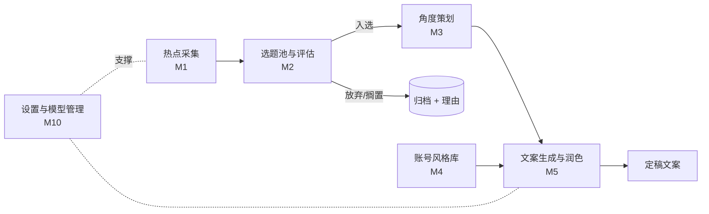

# OneStudio 需求文档

> 短视频博主自媒体创作工作台 · 账号定位：AI 知识科普（面向 AI 小白） · 发布平台：抖音、小红书
> 文档日期：2026-10-22 ｜ 状态：待评审

---

## 1. 项目概述

### 1.1 背景与问题

账号做 AI 工具使用技巧类科普（WorkBuddy 小技巧、Codex 使用小技巧、用 WorkBuddy 制作爆火视频的「知识大赏」等），形式为真人出镜口播，剪辑成知识分享视频，发布在抖音和小红书。

1. **时效性强**：AI 工具更新快，选题窗口短。
2. **事实准确性要求高**：功能、版本、操作步骤讲错，会误导小白观众。
3. **流程分散**：找热点、判断值不值得做、定角度、写稿分散在多个工具里，过程没有沉淀，改稿难回看。

### 1.2 产品定位

本地优先的个人创作工作台，前期先打通**选题到文案**这一段：

```
发现热点 → 判断值不值得做 → 确定角度 → 按账号风格写稿 → 定稿文案
```

### 1.3 目标

| 编号 | 目标 | 衡量方式（建议） |
|---|---|---|
| G1 | 缩短"找选题"时间 | 每天打开热点雷达后 ≤10 分钟完成筛选 |
| G2 | 选题决策有依据、有记录 | 每个入选/放弃的选题都有评分与理由 |
| G3 | 文案稳定贴合账号风格 | 初稿风格人工评分 ≥4/5，改稿轮次下降 |
| G4 | 稿件可回看、可回滚 | 任意稿件版本能看到生成条件 |

---

## 2. 用户与账号画像

| 项 | 内容 |
|---|---|
| 用户 | 博主本人（策划 + 写稿 + 出镜 + 剪辑），能本地部署并配置 API Key |
| 领域与受众 | AI 知识科普，受众是 AI 小白，目标是"看完就能用" |
| 内容支柱 | ① WorkBuddy 小技巧 ② Codex 使用小技巧 ③ 用 WorkBuddy 制作爆火视频的「知识大赏」 ④ AI 热点解读 |
| 形式 | 真人出镜口播 + 屏幕演示，，首版围绕短视频口播稿设计 |
| 平台 | 抖音（短视频口播）、小红书（视频笔记为主，图文笔记为辅） |

---

## 3. 核心流程（前期范围）



**选题状态**：`新发现 → 待评估 → 已入选 → 写作中 → 已定稿`；分支：`搁置`、`放弃`（必须填写理由）、`已过期`。

---

## 4. 功能需求

优先级：**P0** = 第一版必须；**P1** = 第二版；**P2** = 以后再说。

### M1 热点采集与发现

| ID | 需求 | 优先级 | 验收要点 |
|---|---|---|---|
| F-101 | 信源管理：增删改信源。类型：RSS、网页、GitHub Trending、Hacker News、官方更新日志/博客、热榜、手动录入链接 | P0 | 新增一个 RSS 信源 ≤1 分钟生效 |
| F-102 | 定时采集（每日/每小时可配），失败重试，记录每次运行日志 | P0 | 单信源失败不影响其他；失败原因可见 |
| F-103 | 去重与聚类：同一事件的多条内容合并为一个热点簇，保留全部来源链接 | P0 | 同一事件 ≥3 个来源只出现 1 张卡片 |
| F-104 | 领域过滤：用关键词（含"必须包含/排除"）加一段自然语言描述"我关心什么"，由 LLM 打相关度分；LLM 不可用时回退到关键词匹配 | P0 | 每个热点显示相关度分与一句话理由 |
| F-105 | **抖音/小红书热点与对标作品**：采集两个平台上 AI 相关的热门内容（标题、互动数据、发布时间、作者）和对标账号的近期作品，作为"观众在看什么"的参考 | P1 | 仅采集公开数据，低频限速，可随时关闭 |
| F-106 | 官方更新监听：关注 WorkBuddy、Codex 等工具更新日志，发现新功能即生成选题线索 | P1 | 新版本发布后 24h 内出现线索卡 |
| F-107 | 每日热点简报（LLM 汇总"今日值得关注"） | P1 | 可在应用内查看并复制 |

### M2 选题池与"值不值得做"评估

| ID | 需求 | 优先级 | 验收要点 |
|---|---|---|---|
| F-201 | 选题池（看板/列表）：热点可一键"转为选题"，也可手动新增灵感；每个选题可设"建议发布截止日" | P0 | 选题与来源热点簇保持关联 |
| F-202 | 多维度评分（LLM 初评，人工可改）：时效性、账号契合度、小白需求度、可演示性、差异化、制作成本（反向）、事实风险（反向）。默认模板见附录 12.1 | P0 | 每个维度有分数 + 一句话理由 |
| F-203 | 否决项提示：事实无法核实、涉及侵权或违规、无法亲测等 | P0 | 触发时显示明确原因 |
| F-204 | 放弃/搁置必须填写理由，决策历史可查看 | P0 | 无理由无法放弃 |
| F-205 | 同类选题查重：与已入选/已定稿选题对比，提示重复或可做成系列 | P1 | 显示相似度 Top3 |

### M3 角度策划

| ID | 需求 | 优先级 | 验收要点 |
|---|---|---|---|
| F-301 | 为入选选题一次生成 3–5 个角度（如：一分钟上手、避坑清单、新旧对比、案例拆解、小白误区），每个含：观众痛点、核心观点、开场钩子、预计时长 | P0 | 可选定/合并/重新生成，选定结果被记录 |
| F-302 | 选题 Brief：目标、受众、选定角度、关键信息点、**必须核实的事实**、需要的演示 | P0 | 一键复制/导出 Markdown |
| F-303 | 对标拆解：挂载 1–N 条抖音/小红书对标作品，生成拆解（钩子、结构、爆点、可借鉴点、不可照抄点） | P1 | 拆解结果可编辑 |

### M4 账号风格库（Style Profile）

| ID | 需求 | 优先级 | 验收要点 |
|---|---|---|---|
| F-401 | 导入代表作文案作为样本，提取风格特征：句式长度、口头禅、语气、节奏、开头/结尾套路、称呼、禁用词；生成可编辑的"风格说明书" | P0 | 说明书可读、可手动修改 |
| F-402 | 风格档案版本化；支持**平台子风格**（抖音口播 / 小红书笔记）与内容支柱子风格 | P0 | 稿件能显示"使用了风格 vX / 子风格" |
| F-403 | 风格约束清单：必须有/禁止有（如"每条必须有一个可跟做的步骤""禁用'震惊'"），生成后自动检查并标出违规处 | P0 | 违规项高亮 |
| F-404 | 风格一致性检查：新稿与风格档案对比，指出偏离点并可一键"按风格重写" | P1 | 偏离点可定位到句子 |

### M5 文案生成与润色

| ID | 需求 | 优先级 | 验收要点 |
|---|---|---|---|
| F-501 | 基于「Brief + 选定角度 + 风格版本」生成口播文案；可设目标时长（按语速换算字数） | P0 | 输出带时长估算 |
| F-502 | 润色模式（可组合）：口语化、去"AI 味"、精简、强化钩子、补案例、小白化（术语翻白话）、调到 N 秒 | P0 | 每次润色生成新版本，不覆盖旧版本 |
| F-503 | 选区改写：选中一段，输入指令局部重写 | P0 | 改动只影响选区 |
| F-504 | 版本历史与对比（diff）、一键回滚 | P0 | 任意两版可对比 |
| F-505 | 生成记录（最小追溯）：每个版本记录所用选题/角度/风格版本/提示词模板版本/模型与参数/生成时间/触发者（AI 或人工） | P0 | 点击版本可查看生成条件 |
| F-506 | **事实核查标注**：自动标出稿件中的"需核实断言"（功能名、版本号、价格、操作路径、数据），可挂来源链接或标记"已亲测" | P0 | 未核实断言有醒目提示 |
| F-507 | 双平台适配：同一稿件生成**抖音版**（口播 + 标题 + 简介 + 话题）和**小红书版**（标题 + 正文/口播简介 + 标签），保留与母稿的关联 | P1 | 两个平台版本分别可编辑 |

### M6 设置与模型管理

| ID | 需求 | 优先级 | 验收要点 |
|---|---|---|---|
| F-601 | 多模型接入（OpenAI / Anthropic / DeepSeek / 通义等兼容接口），可按任务指定模型（评分用便宜模型、写稿用强模型） | P0 | 切换模型无需改代码 |
| F-602 | API Key 仅存本机，不上传 | P0 | 本地配置/本地加密存储 |
| F-603 | 提示词模板管理（版本化、可编辑） | P0 | 修改模板不影响历史记录 |
| F-604 | 用量与成本统计（按任务/按选题） | P1 | 能看到每个选题花费 |

---

## 5. 页面清单

| 页面 | 作用 | 关键元素 |
|---|---|---|
| 热点雷达 | 每日扫一眼 | 热点簇卡片、相关度分、来源数、"转为选题"、信源健康状态 |
| 选题池 | 决策 | 看板（状态列）、评分、截止日、否决提示 |
| 选题工作区 | 单个选题的主战场 | Tab：Brief / 角度 / 文案；右侧 AI 助手与来源引用 |
| 文案编辑器 | 写稿与润色 | 选区改写、版本对比、事实核查标注、时长估算、平台版本切换 |
| 风格库 | 账号风格资产 | 样本、风格说明书、约束清单、版本 |
| 设置 | 配置 | 信源、模型、提示词模板、用量 |

---

## 6. 数据模型（核心实体）

| 实体 | 关键字段 |
|---|---|
| Source（信源） | 类型、配置、调度频率、状态、最近成功时间 |
| RawItem（原始条目） | 来源、标题、链接、摘要、发布时间、平台、互动数据（如有）、哈希 |
| HotCluster（热点簇） | 标题、条目集合、相关度分与理由、首次/最近出现时间 |
| Topic（选题） | 来自热点簇、状态、支柱标签、截止日、放弃/搁置理由 |
| TopicScore（评分） | 维度、分数、理由、评分者（AI/人）、时间 |
| Angle（角度） | 观点、钩子、预计时长、是否选定 |
| StyleProfile（风格档案） | 版本、平台/支柱子风格、特征、约束清单、样本 |
| Draft / DraftVersion（稿件/版本） | 内容、平台、父版本、生成条件（输入、模板版本、模型、参数、风格版本）、事实核查状态 |
| PromptTemplate（提示词模板） | 名称、版本、内容、适用环节 |
| RunLog（运行日志） | 任务类型、状态、耗时、成本 |

---

## 7. 技术方案建议

| 维度 | 建议 |
|---|---|
| 形态 | 本地运行的全栈 Web 应用，数据与密钥不出本机 |
| 前端 / 后端 | React + Vite + TypeScript / Fastify |
| 存储 | SQLite + 本地文件夹（导出文件）；全文检索用 SQLite FTS |
| 调度 | 进程内 cron + 简单任务队列，失败重试，写 RunLog |
| LLM 层 | 统一抽象（provider、按任务路由、重试、成本记录），所有调用绑定提示词模板版本 |
| 采集层 | 插件式 Collector：v0.1 先做 RSS / GitHub Trending / HN / 官方日志；抖音、小红书采集作为可选插件，放到 v0.2，可通过子进程或本地服务调用 MediaCrawler |

---

## 8. 非功能需求、合规与风险

| 项 | 说明 / 应对 |
|---|---|
| 本地优先 | 数据与 API Key 存本机；联网仅用于采集和调用模型 |
| 可靠性 | 任一信源或模型失败不影响整体；LLM 不可用时过滤降级为关键词规则 |
| 可解释 | 评分、过滤、改写都给出理由，不做黑箱分数 |
| 可迁移 | 随时整库导出 JSON + Markdown |
| 平台采集合规 | 抖音、小红书的自动化采集可能违反平台条款并触发风控；MediaCrawler 自身也强调仅供学习。应对：仅采集公开数据、低频限速、个人研究用途、不采集隐私信息，且作为可关闭的可选插件 |
| 开源许可证 | TrendRadar 多数来源标注 GPL-3.0（copyleft），MediaCrawler 为自定义许可。以"借鉴设计 + 独立部署后读取输出"为主，复用代码前先核对 LICENSE |
| 事实错误 | AI 科普最大风险：F-506 事实核查标注，发布前提醒 |
| AI 味过重 | 风格库 + 禁用词约束 + 润色模式"去 AI 味" |
| 上游依赖 | TrendRadar 的数据主要来自 newsnow 接口，接口变动会影响数据；OneStudio 自有信源（RSS 等）作为兜底 |

---

## 9. 竞品调研（GitHub）

### 9.1 结论

结合你的发布平台（抖音、小红书），最有参考价值的是这两个项目：

- **TrendRadar**：解决"每天看什么热点"，对应 M1。
- **MediaCrawler**：解决"抖音/小红书上别人在做什么、观众在评论什么"，对应 F-105、F-303。

两者都只做到"数据获取"这一步，**没有选题评估、角度策划、风格化写稿和版本管理**，这正是 OneStudio 要自建的部分。

> 数据说明：Star 数来自第三方聚合站，不同来源、不同时间差异较大，仅作量级参考，开发前请到仓库页核对最新 Star 数和 LICENSE。

### 9.2 TrendRadar —— 热点聚合与智能筛选

| 项 | 内容 |
|---|---|
| 仓库 | https://github.com/sansan0/TrendRadar |
| 技术栈 | Python；支持 Docker、本地运行等部署方式；支持 MCP |
| 热度 | 约 4.7 万～6 万 Star（各来源数字不一，较新的为 dev.co 页面约 6 万，2026-07） |
| 许可证 | 多数来源标注 GPL-3.0（copyleft，衍生作品需同样开源）；个别页面标注不同，**以仓库 LICENSE 为准** |
| 核心能力 | 聚合 35+ 平台热榜（含抖音、知乎、B 站、微博等）和 RSS；关键词筛选（含"必须包含"与排除词）；三种推送模式（增量/当前/每日汇总）；AI 智能筛选、翻译与分析简报；多渠道推送（企业微信、飞书、钉钉、Telegram、邮件、ntfy 等）；MCP 提供趋势追踪、情感分析、相似检索等分析能力 |
| 抖音 / 小红书覆盖 | 抖音热榜在支持列表中；**小红书是否覆盖，我在调研资料中没有确认**，需到仓库核实，小红书部分可能需要靠 MediaCrawler 补充 |
| 值得借鉴 | ① 关键词 + 必须词 + 排除词 + 自然语言兴趣描述的过滤设计，LLM 失败时回退关键词（F-104）；② 增量/当前/每日三种模式的信息呈现方式（F-107）；③ 定时采集与失败兜底的工程做法（F-102） |
| 局限 | 热榜以综合新闻和热搜为主，不是 AI 垂类，需要靠关键词和相关度过滤才能得到 AI 选题；数据依赖 newsnow 接口；没有选题评估与写作环节 |
| 建议用法 | v0.1 以借鉴设计为主，自建 RSS/GitHub/HN/官方日志采集；如需综合热榜，可独立部署 TrendRadar 并读取其输出作为一个信源（GPL-3.0 下独立运行、不嵌入代码，风险更低） |

### 9.3 MediaCrawler —— 抖音/小红书等平台内容与评论采集

| 项 | 内容 |
|---|---|
| 仓库 | https://github.com/NanmiCoder/MediaCrawler |
| 技术栈 | Python + Playwright |
| 热度 | 约 5.96 万 Star（Star History，2026-08-01） |
| 许可证 | 自定义（Star History 显示 NOASSERTION），README 强调仅供学习，**商用前务必阅读 LICENSE** |
| 核心能力 | 支持**小红书**、**抖音**、快手、B 站、微博、贴吧、知乎；按关键词、内容 ID、创作者主页采集笔记/视频及二级评论；登录态缓存；代理池；词云；多种存储（CSV / JSON / Excel / SQLite / MySQL / MongoDB）；WebUI |
| 值得借鉴 | ① 按关键词采集"AI 工具""WorkBuddy""Codex"等在两个平台上的热门内容，了解什么标题和话题数据好（F-105）；② 按创作者主页采集对标账号作品，配合拆解（F-303）；③ SQLite 存储和插件化的平台适配思路 |
| 局限 | 纯采集工具，没有分析、评估、写作；需要登录态，抖音登录可能需要手动通过滑块/短信验证；平台风控变化后可能失效，需要持续跟进更新 |
| 风险 | 合规与风控风险是所有功能里最高的（见第 8 章）。建议 v0.1 不集成，v0.2 作为**可选插件**，且限定低频、仅公开数据、账号用小号或自己的号并自担风险 |
| 建议用法 | 独立部署，通过本地调用或读取其输出库（如 SQLite）接入；OneStudio 只负责读取、清洗和分析，不重写爬虫 |

### 9.4 能力对比

✅ 完整 ／ ◐ 部分 ／ ✗ 无

| 能力 | TrendRadar | MediaCrawler | **OneStudio（前期）** |
|---|---|---|---|
| 综合热榜聚合 | ✅ | ✗ | ◐（RSS/GitHub/HN/官方日志，可读取 TrendRadar 输出） |
| 抖音内容采集 | ◐（热榜） | ✅ | ◐（v0.2，通过 MediaCrawler） |
| 小红书内容采集 | 待核实 | ✅ | ◐（v0.2，通过 MediaCrawler） |
| 评论采集 | ✗ | ✅ | ◐（v0.2，视需要） |
| AI 领域关键词与相关度过滤 | ◐（关键词 + AI 筛选） | ✗ | ✅ |
| 选题评分与决策记录 | ✗ | ✗ | ✅ |
| 角度策划 | ✗ | ✗ | ✅ |
| 账号风格库 | ✗ | ✗ | ✅ |
| 文案生成、润色与版本管理 | ✗ | ✗ | ✅ |

---

## 10. 里程碑与 MVP

| 版本 | 范围 | 验收 |
|---|---|---|
| **v0.1** | M1（F-101~F-104）、M2（F-201~F-204）、M3（F-301、F-302）、M4（F-401~F-403）、M5（F-501~F-506）、M6（F-601~F-603） | 用一条真实选题（如某个 WorkBuddy 小技巧）完整走通：热点 → 评分入选 → 选定角度 → 按风格生成并润色口播稿 → 标出待核实断言 → 稿件版本可回看 |
| **v0.2** | F-105（抖音/小红书采集插件）、F-106、F-107、F-205、F-303、F-404、F-507、F-604 | 能看到两个平台上的相关热门内容，并一键生成抖音版与小红书版文案 |
| **v0.3 及以后** | 待优化补充 | — |

---

## 11. 附录

### 11.1 选题评分表（默认模板，权重可配置）

| 维度 | 默认权重 | 打分提示 |
|---|---|---|
| 时效性 | 20% | 热度是否在上升？窗口还剩几天？ |
| 账号契合度 | 20% | 是否属于 AI 科普、是否服务 AI 小白？ |
| 小白需求度 | 20% | 小白是否真的会遇到这个问题？ |
| 可演示性 | 15% | 能否用录屏/实操在 1–3 分钟内演示清楚？ |
| 差异化 | 10% | 同类视频是否已经泛滥？有什么独特角度？ |
| 制作成本（反向） | 10% | 需要多少准备和拍摄时间？ |
| 事实风险（反向） | 5% | 信息能否核实？是否容易讲错？ |

**否决项**：无法亲测或核实 / 涉及版权或违规风险 / 信息只来自单一未证实传言。

### 11.2 风格档案示例

```yaml
style_profile:
  version: v1
  pillar: 技巧类
  platform_variants:
    douyin: 口播为主，开头 3 秒抛卡点，短句，结尾引导关注
    xiaohongshu: 标题含关键词，正文分点，结尾引导收藏
  tone: 亲切、直接、不说教，像懂行的朋友
  address_audience: "你"
  sentence_rhythm: 短句为主，每句不超过 20 字
  must_have:
    - 每条至少一个可跟做的具体步骤
    - 术语第一次出现必须用白话解释
  forbidden_words: ["震惊", "颠覆", "炸裂"]
  samples: [sample_001, sample_002, sample_003]
```

### 11.3 AI 流水线提示词链（示意）

1. **相关度过滤**：热点 + 账号定位 → 相关度与理由
2. **选题评估**：热点簇 + 评分表 → 分维度评分与否决项
3. **角度生成**：选题 → 3–5 个角度
4. **口播初稿**：Brief + 角度 + 风格档案 → 稿件（带时长估算）
5. **润色/改写**：稿件 + 指令 → 新版本
6. **事实核查**：稿件 → 待核实断言清单 + 建议来源

每一步都写入 RunLog，并绑定提示词模板版本与模型参数（F-505、F-603）。
